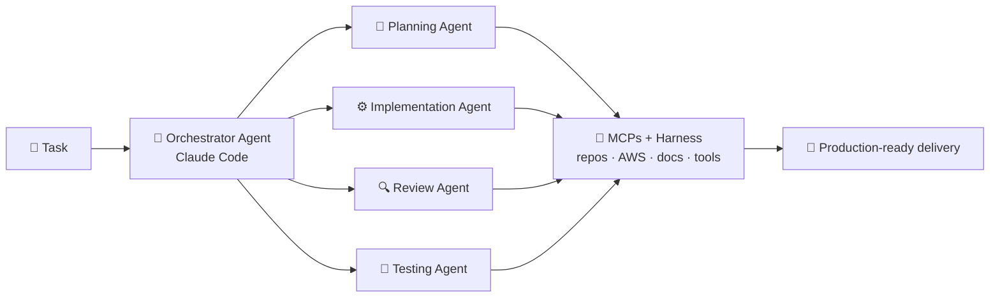

<div align="center">

# Hi, I'm Juan Alejandro 👋

<a href="https://git.io/typing-svg"></a>

**8+ years building resilient, cloud-native systems — now supercharged with AI agents.**

[](https://www.linkedin.com/in/juan-alejandro-miranda-barrera-a57b14167/)
[](mailto:ale.miranda.barrera@gmail.com)


</div>

---

## 🧠 About Me

```ts
const juan = {
  role: "Full Stack & Cloud Engineer",
  experience: "8+ years",
  focus: ["AI-Driven Development", "AWS Serverless", "Distributed Systems"],
  architecture: ["Hexagonal", "Clean Architecture", "Event-Driven", "Microfrontends"],
  aiWorkflow: ["Claude Code", "Orchestrator Agents", "Harnesses", "MCPs"],
  principles: ["SOLID", "Clean Code", "Design Patterns", "Resilience First"],
  languages: { spanish: "Native", english: "B2" },
};
```

I design and ship **mission-critical systems** where stability is non-negotiable: serverless and event-driven architectures on **AWS**, integrations with **distributed systems and third-party services** (REST, SOAP, webhooks), and full stack products with **React, Node.js, and TypeScript**.

---

## 🤖 How I Build with AI

AI is not a side tool in my workflow — it's the engine. I work with **orchestrator agents that coordinate specialized sub-agents** to plan, implement, review, and test code, extended with **MCPs** and custom **harnesses** that connect them to real tools and context.



<div align="center">


</div>

---

## 🚀 Highlights

| | Company | Impact |
|:-:|---|---|
| ☁️ | **Melonn** · Full Stack & Cloud Engineer | Mission-critical courier integrations for a fulfillment platform across **Colombia, Mexico, and Chile**, built on a **resilient, event-driven AWS architecture** where every release demanded maximum stability. |
| 📬 | **Talent.com** · Full Stack Developer | Scaled a notification system to **4–5 million emails
